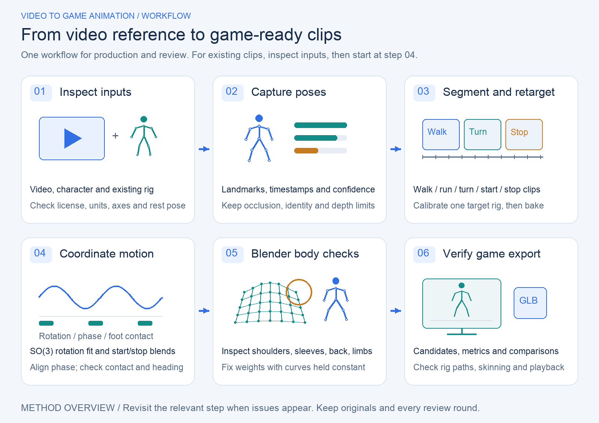
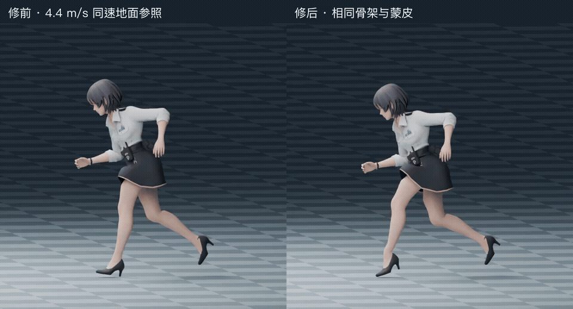
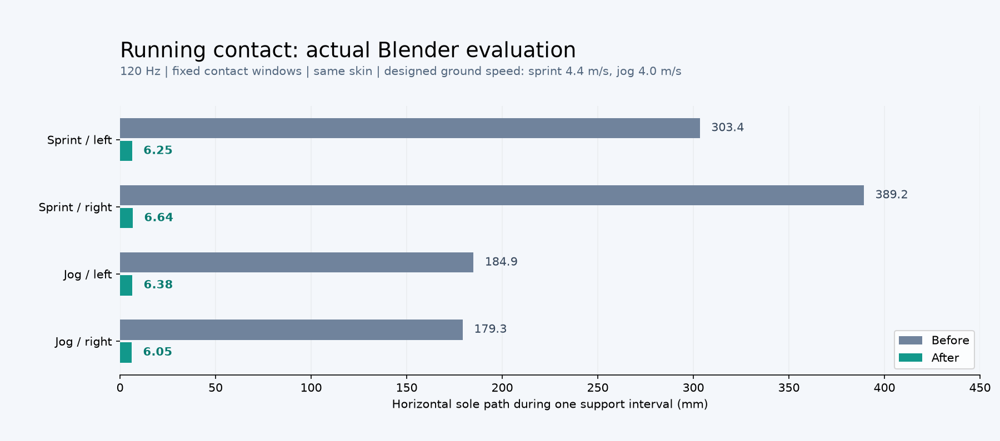
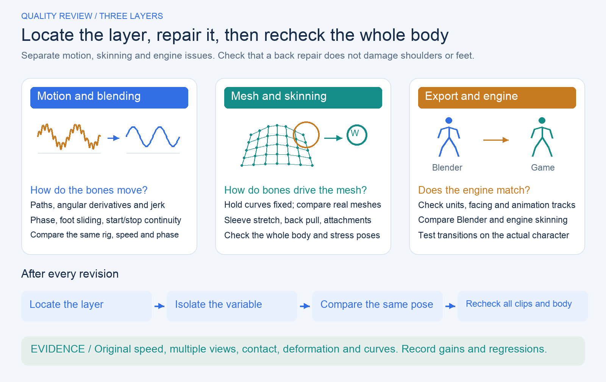

# Video to Game Animation

[简体中文](README.md) | **English**

**From video reference to game character animation you can inspect in Blender.** A Codex skill built from practical work on monocular pose estimation, motion segmentation, retargeting, phase coordination, mathematical diagnostics, skinning repair, and Blender validation.



This repository combines `video-to-game-animation` and `animation-quality-review` into one installable skill. It supports both producing animations and reviewing existing ones. See [quality-review.md](references/quality-review.md) for the review workflow, and [metrics.md](references/metrics.md) and [locomotion-framework.md](references/locomotion-framework.md) for the mathematical scope and limitations.

The skill guides an agent through the work and includes runnable utilities. It is not a one-click system that can capture, rig, and produce natural motion for any character.

This README, its overview diagrams, and the [media provenance notes](docs/showcase/MEDIA.en.md) are available in English. The skill instructions and detailed reference documents are currently in Simplified Chinese.

## Results and process

### Latest revision: match running foot contact to actual displacement



**Left: before. Right: after. Same rig, shoulder/sleeve skinning, and designed root speed of 4.4 m/s.** The checker floor stays fixed while the character advances and the camera follows. Two native-speed sprint cycles total 40 frames at 30 fps. Root speed is a designed input to this contact experiment, not a recovered world trajectory from the source video.

The revision constrains stance-foot trajectories and orientation and stabilizes the knee bend plane. In the game, actual displacement after collision advances gait phase, followed by world-space foot plants and lifted recovery steps. Entering idle no longer snaps a fading contact back to its old anchor. Upper-body animation curves and skinning weights are preserved.



Sprint horizontal path length per support interval falls from **303 / 389 mm to 6.25 / 6.64 mm**. These are actual 120 Hz evaluations over fixed phase intervals, with no velocity-based sample rejection. Separate Godot flat-ground checks at 60 and 30 fps each evaluate 1,880 samples, covering starts/stops, eight release timings, gait changes, and collision. Maximum fully planted drift is **0.300 / 0.258 mm**, respectively. Baked-motion and runtime-foot-lock measurements are separate experiments. Slopes, sharp turns, and final naturalness remain outside acceptance.

[Original-speed comparison MP4](docs/showcase/running-contact-before-after.mp4) · [Measurements and contact definition](docs/showcase/data/running-contact.json) · [Plot source](scripts/plot_running_contact.py) · [Media sources and scope](docs/showcase/MEDIA.en.md)

### Earlier walking-coordination revision

These are actual intermediate results from one character project. **Left: captured motion with earlier cleanup. Right: a revision coordinated with reference animation.** This is not a comparison between untouched video keypoints and a finished character. Each side shows front and side views. Both walk cycles last **1.167 seconds**, repeated three times at their original speed.


[Original-speed MP4](docs/showcase/walk-before-after.mp4) · [Per-joint metrics](docs/showcase/data/walk-metrics.json) · [Media provenance and scope](docs/showcase/MEDIA.en.md)

### 1. Raw capture: inspect what the model actually estimated

The 33 landmarks below come from **02:33.800–02:34.967** of the reference video. Their original coordinates and confidence values are preserved, with no smoothing or retargeting. The animation projects the actual model output into front and oblique skeleton views. Green and orange indicate higher and lower visibility at the endpoints of each drawn edge. Wrist and body-direction instability remain visible, along with the uncertainty of monocular depth estimation.


[Source video timestamp](https://www.youtube.com/watch?v=4NccLyRQQZY&t=153s) · [Reposted source recorded by the project](https://open.video/@ign/v/varsapura-official-gameplay-video-2) · [Raw estimates as JSON](docs/showcase/data/raw-walk-capture.json) · [Original-speed skeleton MP4](docs/showcase/raw-capture.mp4)

These are **model estimates** in hip-centered coordinates, not calibrated world trajectories. The original footage is linked; the published animation redraws the landmarks. The JSON contains 36 time samples. The preview plays 35 frames, omitting the terminal sample to avoid counting the time boundary twice. Repetition helps inspection; it does not mean the raw capture is seamless.

### 2. Motion optimization: bone axes → rotation space → phase → contact

| Observed problem | Method used in this project | What to preserve or check next |
| --- | --- | --- |
| A/T-pose mismatch, applying the arm-down correction twice, wrist twist | Calibrate source/target rest poses and bone axes; use reference motion for unobservable twist | Preserve bone lengths; validate a single arm and elbow bend before baking the full clip |
| Upper-body jitter and mechanical coordination | Fit periodic motion in SO(3) Log/Exp space and use a reference at the same phase | This is neither independent low-pass filtering of quaternion components nor just smoothing the raw capture |
| Unnatural walk/run and start/stop transitions | Align phase using same-side contact events; advance phase and apply quintic blend weights | Smooth weights alone do not guarantee contact or continuity across all keyframes |
| Body bobbing driven by whichever foot is lowest | Separate body motion from ground-height correction; use actual shoe soles and two-bone height IK | Height IK does not provide horizontal foot locking; turning foot placement needs separate work |

For periodic rotation, use $r(\phi)=\log(q(\phi)q_0^{-1})$, fit a finite set of harmonics to $r$, then reconstruct with $q=\exp(r)q_0$. Start/stop blending uses $w(s)=10s^3-15s^4+6s^5$. The weight's first and second derivatives vanish at both ends, but source-motion compatibility and contact still need checking.


The figure above is an **explicitly labeled mathematical illustration**. The left panel shows the blend envelope; the right explains why averaging opposite phases can cancel limb swing. The next figure uses **actual Blender-evaluated data**. The two types of evidence are kept separate.


| Measurement over the same cycle | Before | After | Interpretation |
| --- | ---: | ---: | --- |
| Head jerk RMS (m/s³) | 100.73 | 14.86 | Substantial reduction in higher-order body/head jitter |
| Chest jerk RMS (m/s³) | 49.76 | 14.04 | More continuous torso trajectories |
| Left-hand angular acceleration P95 (rad/s²) | 43.25 | 20.47 | Smaller abrupt changes in the wrist/parent chain |
| Right-foot jerk RMS (m/s³) | 92.61 | 105.44 | **Not every metric improved**; the feet still need review |
| Left-foot angular acceleration P95 (rad/s²) | 11.30 | 54.04 | Foot rotation changed; better upper-body metrics cannot certify the whole character |

Both measurements use 30 Hz world-space trajectories, central differences, and the same boundary exclusion rules. Jerk statistics discard the first and last three samples; the plot still shows the complete sampled curves. The revised motion uses reference-assisted reconstruction with [Quaternius UAL (CC0)](https://quaternius.com/packs/universalanimationlibrary.html), preserving the reference video's motion intent and this walk cycle's duration. **It is neither an exact reconstruction of the video nor a controlled experiment in pure denoising.** Horizontal foot locking and the true root path have not been accepted. These are local diagnostics, not a universal naturalness score.

[Before: evaluated trajectories](docs/showcase/data/before-walk.json) · [After: evaluated trajectories](docs/showcase/data/after-walk.json) · [Mathematical framework and limitations](references/motion-math.md)

### 3. Why can a smoother arm still pull the whole back?

This comparison changes **static skinning weights**. Both sides use the same `Run_Stop` animation curves, skeleton, and timing. The left uses the original weights; the right uses the first back-binding revision. Normal torso rotation is preserved.


[Original-speed MP4](docs/showcase/back-binding-before-after.mp4)

Keep root and torso motion unchanged, disable local shoulder/arm rotations, and compare evaluated mesh positions: $d_v(t)=\lVert x_{full,v}(t)-x_{disabled,v}(t)\rVert$. Across **122 central-back vertices selected in advance**, the maximum shoulder/arm contribution fell from **23.785 mm → 5.500 mm**. This measures the influence of a motion chain; frozen arms are a diagnostic intervention, not a natural performance.


**The first revision did not finish the repair.** The central back became more stable, but the peak edge-length ratio in the earlier, broader region—including the adjacent armhole—increased from 1.972 to 2.174. That regression motivated the next revision: protect the central back, optimize static weights across the shoulder and sleeve using multiple poses, and recheck how buttons and badges follow the cloth.

### 4. Refining the shoulder and sleeve: the actual optimization trace

Hold the motion fixed and optimize only static skinning weights $W$. The objective has three terms:

```math
\begin{aligned}
E(W)={}&\sum_{p,e}\rho(r_e(W;p);l_e,u_e)\\
&+\lambda_{keep}\sum_{p,v}\lVert x_v(W;p)-x_{baseline,v}(p)\rVert^2\\
&+\lambda_{graph}\sum_{(i,j)}\lVert W_i-W_j\rVert^2
\end{aligned}
```

The first term penalizes edge-length ratios outside the allowed range across poses. The second preserves shape, and the third discourages abrupt changes between neighboring weights. The bounds $l_e,u_e$ are project-specific. Constraints require $W_{vj}\ge0$ and $\sum_jW_{vj}=1$, while protected regions stay unchanged. This is a project fitting objective, not a law of human naturalness.

The fit uses **63 poses and 4,362 vertices**. Before optimization, the custom dual-quaternion skinning (DQS) evaluator was checked against Blender, with a maximum position difference of **5.65×10⁻⁷ m**, followed by a gradient check. The solver reached its 200-iteration limit; **convergence and global optimality are not claimed**. The full timeline and independent stress poses were checked separately.


In the legend, `original` means the initial binding, `previous` the first back revision, and `current` the later shoulder/sleeve revision. The loss plot's horizontal axis counts **objective-function evaluations**, not solver iterations. The right panel uses the fixed regions defined for the later shoulder/sleeve task. These differ from the earlier broad region in the previous section, so their values cannot be pooled directly.

| Same Run_Stop motion and regions | Original binding | Back-only revision | Shoulder/sleeve revision |
| --- | ---: | ---: | ---: |
| Shoulder peak edge-length ratio | 1.781 | 1.781 | 1.507 |
| Armhole peak edge-length ratio | 4.041 | 4.041 | 1.795 |
| Upper-sleeve peak edge-length ratio | 2.473 | 2.396 | 1.726 |
| Central-back shoulder/arm contribution (mm) | 23.785 | 5.500 | 5.500 |

The edge-length ratio is evaluated length divided by rest length. A value closer to 1 means less stretch or compression, but cloth folds can involve legitimate deformation. These values are not scores. Compression, contact, and overall naturalness still need separate acceptance checks.


<details>
<summary>Show the complete run-to-stop clip after shoulder/sleeve refinement (front / side / back)</summary>


[Original-speed MP4](docs/showcase/shoulder-refined-run-stop.mp4) · [Regional measurements for all three versions](docs/showcase/data/run-stop-binding-metrics.json) · [Actual optimization log](docs/showcase/data/shoulder-optimization.json)

</details>

These demonstrations show incremental improvements and the failures that prompted further work. GIF timing is quantized to hundredths of a second; MP4 preserves the original 30 fps. The run-to-stop video displays the terminal frame, so a 1.6-second action produces 1.633 seconds of media. [Frame counts, durations, and hashes](docs/showcase/media-manifest.json) are included.

### Reproduce the figures

You can rebuild all four mathematical figures from the committed measurement snapshots without the original character or video. The script verifies head jerk and left-hand angular acceleration against the recorded metrics.

```sh
python -m pip install -r requirements-showcase.txt
python scripts/plot_showcase.py --data docs/showcase/data --output docs/showcase
```

[Full quality-review framework](references/quality-review.md) · [Skinning isolation and multi-pose fitting](references/skinning.md) · [Sources, versions, and media licensing scope](docs/showcase/MEDIA.en.md)

## When to use this skill

- Extract functional clips such as walking, running, starting, and stopping from character video, accounting for occlusion, incorrect subject detection, and unknown root motion.
- Repair wrist flips, mechanical gait, upper-body sway, loops, and transitions after retargeting.
- Diagnose arms pulling the back, legs dragging skirts, armhole stretching, and clothing attachments separating from the surface.
- Compare animations from different sources on the same target skeleton, distinguishing motion curves, skinning weights, and blend weights.

Start with [SKILL.md](SKILL.md). Tool interfaces are documented in the [data contract](references/data-contract.md), the mathematics in the [motion framework](references/motion-math.md), and lessons from failures in the [case study](references/case-study.md).

## Locate the source of a problem



The two overview diagrams are **method illustrations**. The animations and measured curves above come from the actual project. See the [quality-review reference](references/quality-review.md) for detailed decision criteria and [draw_overview.py](scripts/draw_overview.py) for the diagram generator (Pillow; use `--lang en` with an English-capable font, or a CJK font for the Chinese version).

## Install and use

Clone the repository into your personal skills directory, provided the target directory does not already exist:

```sh
git clone https://github.com/Be1Human/video-to-game-animation.git "${CODEX_HOME:-$HOME/.codex}/skills/video-to-game-animation"
```

In a client that supports skills, ask:

> Use $video-to-game-animation to turn the walking, starting, and stopping in this video into character clips. Inspect the existing rig and data quality first, then optimize phase, contact, and skinning. Preserve the originals and deliver Blender candidates with before/after evidence.

Or request a focused diagnosis:

> Use $video-to-game-animation to investigate why this character's arm swing pulls the back during Run_Stop. Keep the animation curves fixed and compare the evaluated mesh and skinning weights.

The Python utilities can also run without a particular client:

```sh
python -m pip install -r requirements.txt
python -m unittest discover -s scripts -p 'test_*.py' -v
python scripts/make_demo.py --output-dir demo-output
python scripts/analyze_motion.py demo-output/smooth-sliding.json --output demo-output/report.json
```

The demo includes a counterexample with almost zero jerk but 1 m of support-foot sliding, showing why smoothness cannot replace contact constraints. Capture and Blender export commands are in the data contract.

## Included tools and remaining work

| Provided | Must be completed for the actual input |
| --- | --- |
| Local MediaPipe capture entry point with confidence and timestamps | Camera calibration, identity tracking, reliable shots, and clip boundaries |
| Blender-evaluated export and rotation/trajectory analysis | Target bone mapping, rest-pose calibration, IK, and animation baking |
| SO(3) periodic fitting, SLERP, and quintic weights | Whole-body contact optimization, directional foot placement, and anatomical/style constraints |
| Regional mesh-deformation and chain-influence metrics | Regions based on actual topology, a character-specific DQS multi-pose weight solver, and attachment repair |
| Synthetic semantic tests and checks using real project exports | Final original-speed visual review and verification in the game |

There is no universal naturalness score. Video estimates, reference-assisted reconstruction, and authored motion are labeled separately. In-place motion without a world root path must not be presented as verified foot contact. The tools do not bundle the source character, original footage, or pose-model weights, and do not upload inputs implicitly. This README includes demonstration media from the project.

## Validation and licensing

Tested with Python 3.11 / NumPy 2.x and Blender 4.5.3 LTS. See [release validation](references/validation.md) for the scope and limitations. CI checks the mathematical and diagnostic tools; a passing CI run is not artistic acceptance of a character.

The code and skill documentation use the [MIT license](LICENSE). Reference papers, third-party dependencies, user-supplied characters/videos, and model files remain subject to their respective licenses. This repository does not redistribute the source character model, original footage, or model weights. See [MEDIA.en.md](docs/showcase/MEDIA.en.md) for the demonstration media's provenance and permitted scope. MIT licensing of the code does not grant independent reuse rights to the third-party character. Mathematical references link to the original authors or official sources; this project does not copy or claim to implement complete systems such as PFNN or Footskate Solver.
