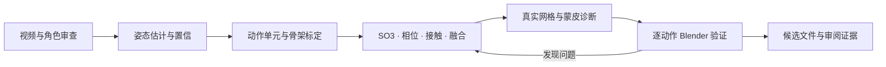

# Video to Game Animation

**从视频参考到可审阅的游戏角色动画。** 一套 Codex skill，沉淀了单目姿态估计、动作拆分、重定向、相位协调、数学诊断、蒙皮修复和 Blender 验证的实际迭代经验。

本仓库已将 `video-to-game-animation` 与 `animation-quality-review` 合并为一个可安装技能：既支持完整制作，也支持对现有动画直接评审。质量评估入口见 [quality-review.md](references/quality-review.md)，完整数学边界见 [metrics.md](references/metrics.md) 和 [locomotion-framework.md](references/locomotion-framework.md)。

它会指导代理完成工作，并提供可运行的小工具；不是一个对任意模型都能一键动捕、绑定和修成自然动作的黑盒程序。



## 适用场景

- 从角色视频提取走、跑、启停等功能动作，处理遮挡、人物误检和未知根轨迹。
- 修重定向后的手腕翻转、机械步态、上身摇晃、循环和动作切换。
- 查摆臂拖后背、腿带裙子、袖窿拉伸及衣料附件脱离。
- 将不同来源动作统一到同一目标骨架比较，区分动作曲线、蒙皮和融合权重。

阅读 [SKILL.md](SKILL.md)；工具接口见 [数据契约](references/data-contract.md)，数学见 [动作框架](references/motion-math.md)，失败经验见 [案例](references/case-study.md)。

## 安装和使用

将本仓库放到个人 skills 目录（目标目录不存在时）：

```sh
git clone https://github.com/Be1Human/video-to-game-animation.git "${CODEX_HOME:-$HOME/.codex}/skills/video-to-game-animation"
```

在支持 skills 的客户端中调用：

> 使用 $video-to-game-animation，把这段视频中的走路、起跑和停步整理成角色动作。先检查现有骨架和数据质量，再优化相位、接触和蒙皮，保留原件，交付 Blender 候选和修前修后证据。

也可以只做局部诊断：

> 使用 $video-to-game-animation，检查这个角色 Run_Stop 摆臂时为什么拖动后背，保持动作曲线不变，比较实际网格和权重。

仅使用 Python 工具不需要特定客户端：

```sh
python -m pip install -r requirements.txt
python -m unittest discover -s scripts -p 'test_*.py' -v
python scripts/make_demo.py --output-dir demo-output
python scripts/analyze_motion.py demo-output/smooth-sliding.json --output demo-output/report.json
```

演示会得到“jerk 接近零，但支撑脚滑移 1 m”的反例，说明平滑不能替代接触约束。视频捕捉和 Blender 导出命令见数据契约。

## 包含与边界

| 已提供 | 需要依据实际输入完成 |
| --- | --- |
| 本地 MediaPipe 捕捉入口、置信/时戳记录 | 相机标定、身份追踪、可靠镜头与动作分段 |
| Blender 实际求值导出、旋转/轨迹分析 | 目标骨架映射、rest 校准、IK 与动作烘焙 |
| SO(3) 周期拟合、SLERP、五次权重 | 全身接触优化、方向落脚、人体/风格约束 |
| 区域网格形变与链依赖度量 | 实际拓扑分区、DQS 多姿势权重求解及附件修复 |
| 合成语义测试与真实工程导出实测 | 用户角色的最终常速观感和游戏运行验收 |

无通用自然度总分。视频估计、参考辅助重建和设计动作分别标注；原地动画没有世界根路径时不伪报脚滑。工具没有模型、视频、角色、付费服务或隐含上传。

## 验证与许可

Python 3.11 / NumPy 2.x；Blender 4.5.3 LTS 实测。验证范围与限制见 [发布验证](references/validation.md)。CI 检查纯数学与诊断工具，不将 CI 通过宣称为角色美术验收。

本仓库代码和技能说明使用 [MIT](LICENSE)。参考论文、第三方依赖、用户角色/视频和模型文件受各自许可约束，本仓库未再分发这些资产。数学依据直接链接原作者/官方资料；没有复制或声称实现 PFNN、Footskate Solver 等完整系统。
