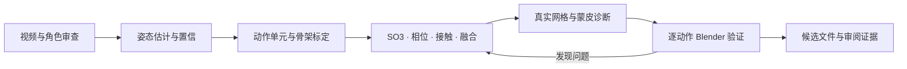
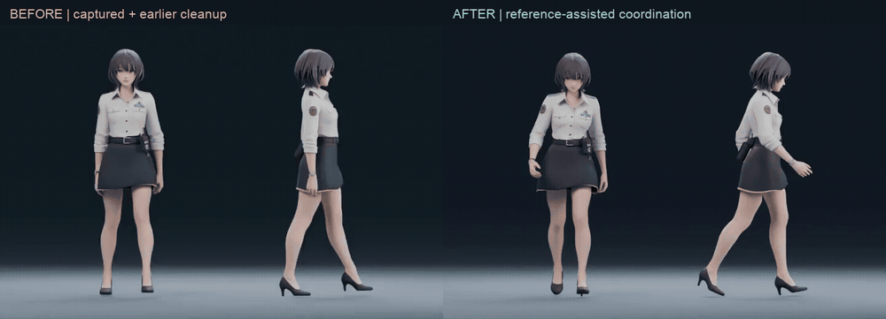
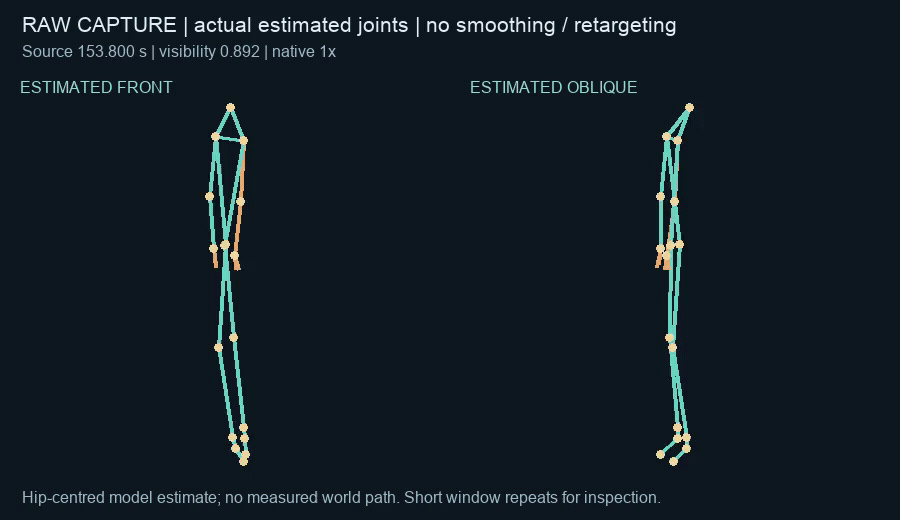
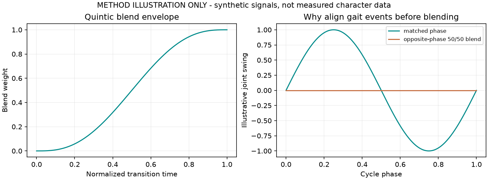
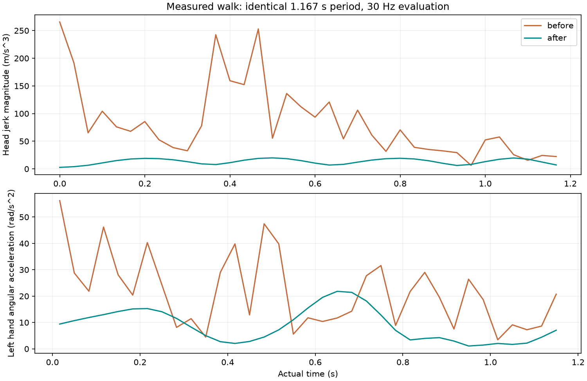
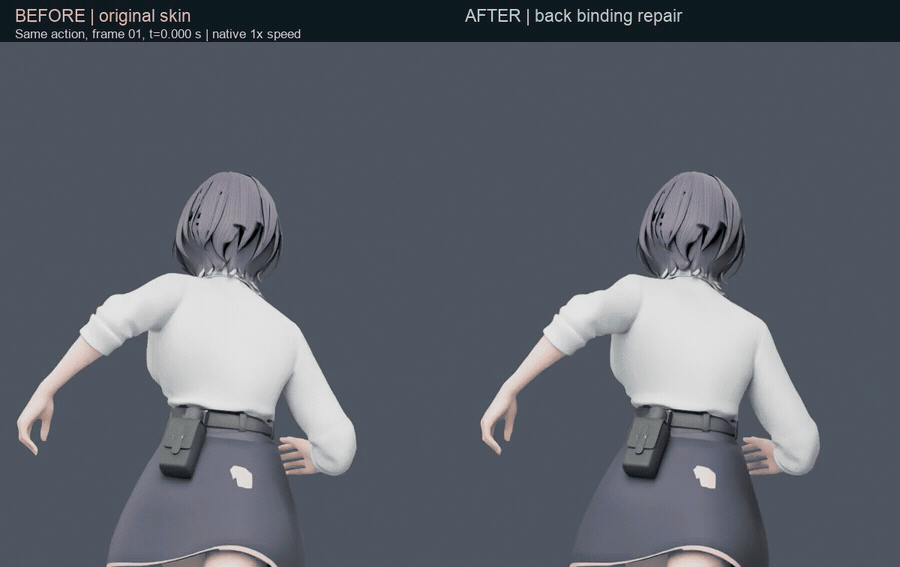
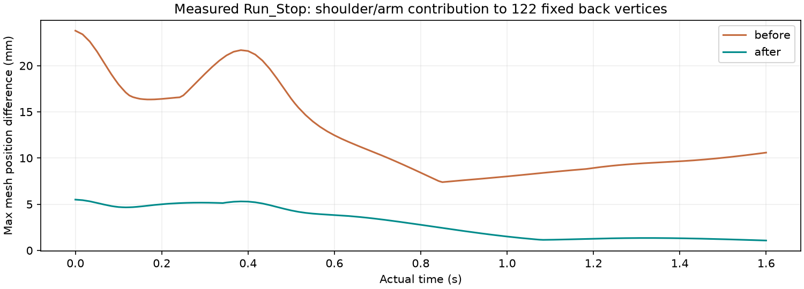
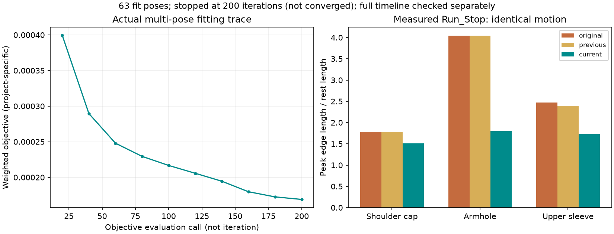
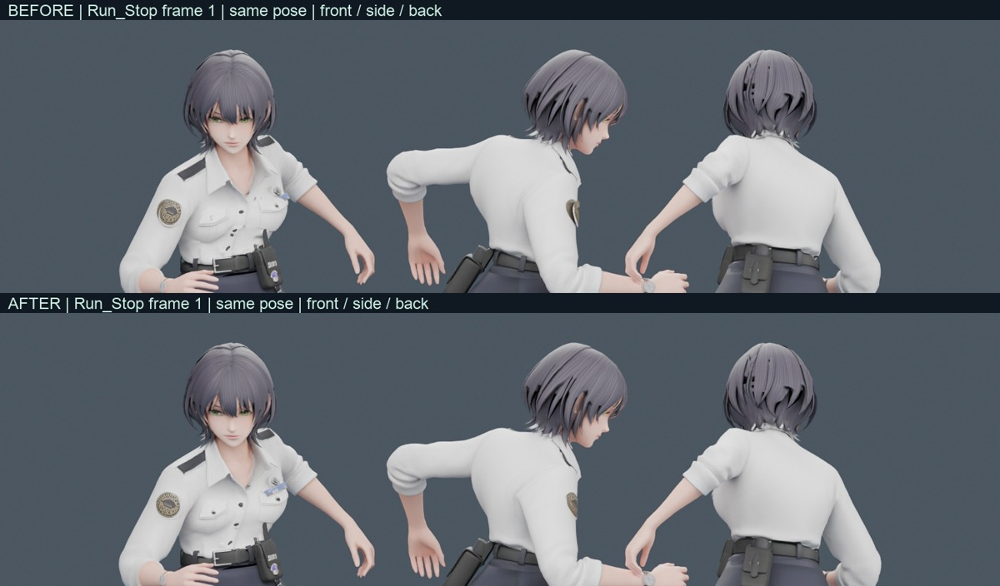
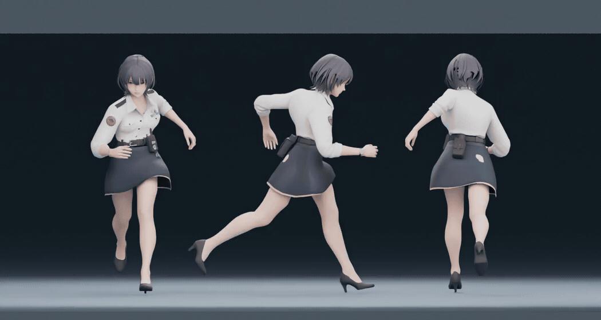

# Video to Game Animation

**从视频参考到可审阅的游戏角色动画。** 一套 Codex skill，沉淀了单目姿态估计、动作拆分、重定向、相位协调、数学诊断、蒙皮修复和 Blender 验证的实际迭代经验。

本仓库已将 `video-to-game-animation` 与 `animation-quality-review` 合并为一个可安装技能：既支持完整制作，也支持对现有动画直接评审。质量评估入口见 [quality-review.md](references/quality-review.md)，完整数学边界见 [metrics.md](references/metrics.md) 和 [locomotion-framework.md](references/locomotion-framework.md)。

它会指导代理完成工作，并提供可运行的小工具；不是一个对任意模型都能一键动捕、绑定和修成自然动作的黑盒程序。



## 实际效果与过程

下面来自同一次角色制作的真实中间产物。**左边是已有捕捉与早期修型，右边是参考辅助协调修订**，不是未经处理的视频关键点直接和成品做对比。每侧都有正面、侧面；两版步行周期同为 **1.167 秒**，按原速重复 3 次。



[原速 MP4](docs/showcase/walk-before-after.mp4) · [逐关节指标](docs/showcase/data/walk-metrics.json) · [媒体来源与范围](docs/showcase/MEDIA.md)

### 1. 原始捕捉：先看到模型实际估计了什么

原片 **02:33.800–02:34.967** 的 33 个关节点，保留原始坐标和置信度，没有做平滑或重定向。下图只是把实际模型输出投影成正面/斜侧面骨线；绿色/橙色表示所用边端点的可见性较高/较低。看得到手腕和身体方向的不稳定，也保留单目深度的不确定性。



[原片时间入口](https://www.youtube.com/watch?v=4NccLyRQQZY&t=153s) · [项目记录的原片转载来源](https://open.video/@ign/v/varsapura-official-gameplay-video-2) · [原始估计 JSON](docs/showcase/data/raw-walk-capture.json) · [原速骨线 MP4](docs/showcase/raw-capture.mp4)

这是髋中心坐标下的**模型估计**，不是标定世界轨迹。原片只链接来源；公开动画是关节点重绘。JSON 含 36 个时间样本，循环预览省去周期终止时刻，避免重复计算时间边界，播放 35 帧；循环播放用于观察，不代表原始捕捉已无缝。

### 2. 中间怎么优化：骨轴 → 旋转空间 → 相位 → 接触

| 发现的问题 | 实际采用的方法 | 要保护或继续检查的内容 |
| --- | --- | --- |
| A/T 姿不一致、手臂重复下压、腕扭转 | 标定源/目标 rest 和骨轴；不可观测 twist 用参考补足 | 固定骨长，先验证单臂/屈肘，再整段烘焙 |
| 上身抖动、四肢配合机械 | 在 SO(3) 的 Log/Exp 空间拟合周期，使用同一相位的参考动作 | 不是分别低通四元数分量，也不是仅把原始捕捉“变平滑” |
| 走跑、起停切换不自然 | 同侧接触事件对齐相位；相位推进配合五次混合权重 | 权重光滑不自动保证接触或全部关键帧连续 |
| 身体随最低脚上下抽动 | 身体起伏与地面高度校正分开；实际鞋底 + 双骨高度 IK | 高度 IK 不等于水平足锁；转向落脚仍需另做 |

周期旋转的核心形式是 $r(\phi)=\log(q(\phi)q_0^{-1})$，对 $r$ 做有限谐波拟合，再用 $q=\exp(r)q_0$ 重建。启停使用 $w(s)=10s^3-15s^4+6s^5$；两端权重的一、二阶导为零，但动作源的兼容性与接触仍要检查。



上图是**明确标注的数学示意**：左图展示混合包络，右图解释对侧相位直接相加为何会抵消摆动。下面则是**实际 Blender 求值数据**，两者没有混用。



| 同一周期的实测 | 修前 | 修后 | 解释 |
| --- | ---: | ---: | --- |
| 头部 jerk RMS（m/s³） | 100.73 | 14.86 | 身体/头部的高阶抖动明显减少 |
| 胸腔 jerk RMS（m/s³） | 49.76 | 14.04 | 躯干轨迹更连贯 |
| 左手角加速度 P95（rad/s²） | 43.25 | 20.47 | 腕部/父链的突变减弱 |
| 右脚 jerk RMS（m/s³） | 92.61 | 105.44 | **并非所有指标改善**，足部仍需复查 |
| 左脚角加速度 P95（rad/s²） | 11.30 | 54.04 | 改变了足部旋转，不能单凭上身指标宣布全身通过 |

测量采用相同 30 Hz 世界轨迹、中心差分和边界舍弃规则；jerk 统计舍弃首尾各 3 样本，图中仍展示完整采样曲线。修改后的动作含 [Quaternius UAL（CC0）](https://quaternius.com/packs/universalanimationlibrary.html) 参考辅助重建，保留原片动作语义及这段步行周期，**不是精确还原原片，也不是纯去噪的因果实验**。水平足锁和真实根路径未验收；这些数值是局部诊断，不是自然度总分。

[修前求值数据](docs/showcase/data/before-walk.json) · [修后求值数据](docs/showcase/data/after-walk.json) · [数学推导与边界](references/motion-math.md)

### 3. 动作平滑了，为什么手还会把后背拖走？

下面改的是**静态蒙皮权重**，两边使用相同 `Run_Stop` 动作曲线、骨架和时间。左为原权重，右为第一轮后背修订，正常躯干转动保留。



[原速 MP4](docs/showcase/back-binding-before-after.mp4)

固定根和躯干，禁用肩臂局部旋转，比较实际求值网格的位置差： $d_v(t)=\lVert x_{full,v}(t)-x_{disabled,v}(t)\rVert$ 。在预先选定的 **122 个中央背部顶点**中，最大肩臂贡献从 **23.785 mm → 5.500 mm**；这测量运动链的影响，不把冻结手臂当作自然表演。



**第一轮并未完成修复：** 中央背部稳定了，但含相邻袖窿的旧版宽区域峰值边长比从 1.972 升至 2.174。这个副作用推动了下一轮：保留中央背部约束，沿整圈肩袖用多姿势优化静态权重，并复查纽扣/徽章与衣料贴合。

### 4. 继续修肩袖：真实优化过程与最后一轮对照

固定动作，只优化静态蒙皮权重 $W$。目标由三项组成：

```math
\begin{aligned}
E(W)={}&\sum_{p,e}\rho(r_e(W;p);l_e,u_e)\\
&+\lambda_{keep}\sum_{p,v}\lVert x_v(W;p)-x_{baseline,v}(p)\rVert^2\\
&+\lambda_{graph}\sum_{(i,j)}\lVert W_i-W_j\rVert^2
\end{aligned}
```

第一项限制各姿势的边长比，第二项保留原形，第三项减少相邻表面的权重突变； $l_e,u_e$ 是项目选定的容许范围。约束 $W_{vj}\ge0$、 $\sum_jW_{vj}=1$ ，保护区域不变。这是项目的拟合目标，不是人体自然度定律。

对 **63 个姿势、4,362 个顶点**拟合，先验证 DQS 自写求值器与 Blender 的最大位置差为 **5.65×10⁻⁷ m**，再检查梯度。求解到 200 次迭代上限，**未宣称收敛或全局最优**；全时间轴与独立试姿另做验证。



图例 `original` 是最初绑定，`previous` 是第一轮背部修订，`current` 是后续肩袖修订。横轴的 loss 采样计数是**目标函数调用次数**，不是迭代编号。右图使用后续肩袖任务固定的分区，和上一节旧版宽区域并非同一取样范围，不能直接混算。

| Run_Stop 同动作、同分区 | 最初绑定 | 仅修背部 | 后续肩袖修订 |
| --- | ---: | ---: | ---: |
| 肩部最大边长比 | 1.781 | 1.781 | 1.507 |
| 袖窿最大边长比 | 4.041 | 4.041 | 1.795 |
| 上袖最大边长比 | 2.473 | 2.396 | 1.726 |
| 中央背部肩臂贡献（mm） | 23.785 | 5.500 | 5.500 |

边长比为求值边长 / rest 边长，越接近 1 越少伸缩，但衣物折叠有合理变形；这些值不是评分。压缩、接触与整体自然度仍需单独验收。



<details>
<summary>展开查看后续肩袖修订的完整跑停动作（正 / 侧 / 背）</summary>



[原速 MP4](docs/showcase/shoulder-refined-run-stop.mp4) · [三版分区测量](docs/showcase/data/run-stop-binding-metrics.json) · [实际优化记录](docs/showcase/data/shoulder-optimization.json)

</details>

以上演示展示阶段性改善与真实失败链。GIF 仅有百分之一秒计时精度，MP4 保存原始 30 fps；跑停视频包含末帧显示，1.6 秒动作的媒体时长为 1.633 秒。[帧数、时长与哈希](docs/showcase/media-manifest.json)均可查。

### 复算这些图

无需原角色或原片，可以从仓库内的测量快照重建四张数学图；脚本会核对头部 jerk 与左手角加速度是否和已记录指标一致。

```sh
python -m pip install -r requirements-showcase.txt
python scripts/plot_showcase.py --data docs/showcase/data --output docs/showcase
```

[完整质量评审框架](references/quality-review.md) · [蒙皮隔离与多姿势方法](references/skinning.md) · [来源、版本及媒体许可范围](docs/showcase/MEDIA.md)

## 适用场景

- 从角色视频提取走、跑、启停等功能动作，处理遮挡、人物误检和未知根轨迹。
- 修重定向后的手腕翻转、机械步态、上身摇晃、循环和动作切换。
- 查摆臂拖后背、腿带裙子、袖窿拉伸及衣料附件脱离。
- 将不同来源动作统一到同一目标骨架比较，区分动作曲线、蒙皮和融合权重。

阅读 [SKILL.md](SKILL.md)；工具接口见 [数据契约](references/data-contract.md)，数学见 [动作框架](references/motion-math.md)，失败经验见 [案例](references/case-study.md)。

## 安装和使用

将本仓库放到个人 skills 目录（目标目录不存在时）：

```sh
git clone https://github.com/Be1Human/video-to-game-animation.git "${CODEX_HOME:-$HOME/.codex}/skills/video-to-game-animation"
```

在支持 skills 的客户端中调用：

> 使用 $video-to-game-animation，把这段视频中的走路、起跑和停步整理成角色动作。先检查现有骨架和数据质量，再优化相位、接触和蒙皮，保留原件，交付 Blender 候选和修前修后证据。

也可以只做局部诊断：

> 使用 $video-to-game-animation，检查这个角色 Run_Stop 摆臂时为什么拖动后背，保持动作曲线不变，比较实际网格和权重。

仅使用 Python 工具不需要特定客户端：

```sh
python -m pip install -r requirements.txt
python -m unittest discover -s scripts -p 'test_*.py' -v
python scripts/make_demo.py --output-dir demo-output
python scripts/analyze_motion.py demo-output/smooth-sliding.json --output demo-output/report.json
```

演示会得到“jerk 接近零，但支撑脚滑移 1 m”的反例，说明平滑不能替代接触约束。视频捕捉和 Blender 导出命令见数据契约。

## 包含与边界

| 已提供 | 需要依据实际输入完成 |
| --- | --- |
| 本地 MediaPipe 捕捉入口、置信/时戳记录 | 相机标定、身份追踪、可靠镜头与动作分段 |
| Blender 实际求值导出、旋转/轨迹分析 | 目标骨架映射、rest 校准、IK 与动作烘焙 |
| SO(3) 周期拟合、SLERP、五次权重 | 全身接触优化、方向落脚、人体/风格约束 |
| 区域网格形变与链依赖度量 | 实际拓扑分区、DQS 多姿势权重求解及附件修复 |
| 合成语义测试与真实工程导出实测 | 用户角色的最终常速观感和游戏运行验收 |

无通用自然度总分。视频估计、参考辅助重建和设计动作分别标注；原地动画没有世界根路径时不伪报脚滑。工具不包含原始角色模型、原片、姿态模型或隐含上传；README 附有本项目的对比演示媒体。

## 验证与许可

Python 3.11 / NumPy 2.x；Blender 4.5.3 LTS 实测。验证范围与限制见 [发布验证](references/validation.md)。CI 检查纯数学与诊断工具，不将 CI 通过宣称为角色美术验收。

本仓库代码和技能说明使用 [MIT](LICENSE)。参考论文、第三方依赖、用户角色/视频和模型文件受各自许可约束，本仓库未再分发原始角色模型、原片或模型权重。新增演示媒体的来源和使用范围见 [MEDIA.md](docs/showcase/MEDIA.md)，不因代码采用 MIT 而获得第三方角色的独立复用许可。数学依据直接链接原作者/官方资料；没有复制或声称实现 PFNN、Footskate Solver 等完整系统。
